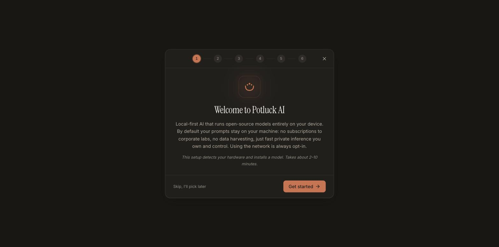
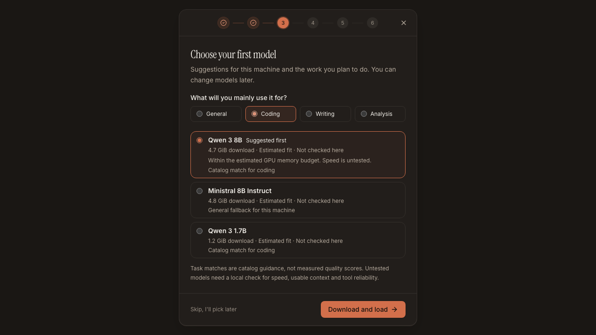
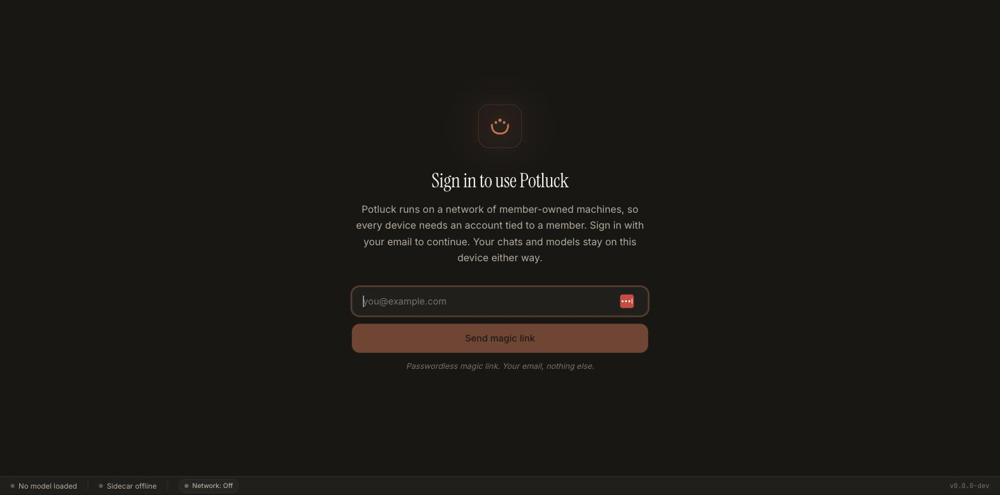
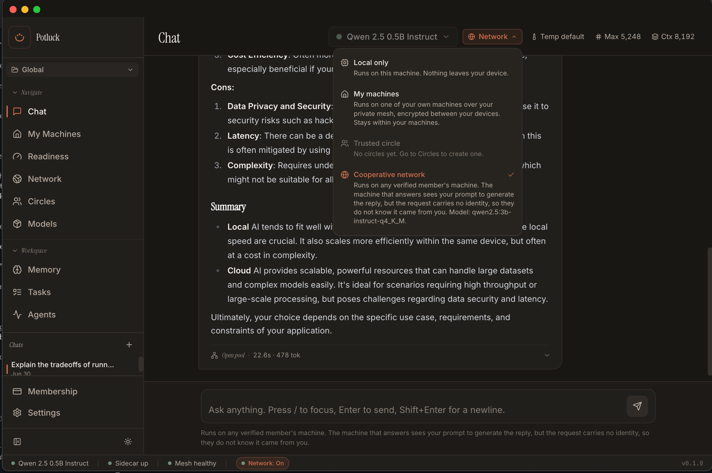

# Getting started with Potluck

Potluck is local-first AI. It runs open-source models on your own machine, and it can join your machines (and, if you choose, other people's) into one private network so you can run bigger models and share the load. Your prompts stay on your machine by default. Using the network is always opt-in.

This guide takes you from zero to running, then shows how to connect your own machines together and how to connect to other people.

- [1. Install the app](#1-install-the-app)
- [2. First run: pick a model and sign in](#2-first-run-pick-a-model-and-sign-in)
- [3. Use it](#3-use-it)
- [4. Add your own machines (your household)](#4-add-your-own-machines-your-household)
- [5. Connect to other people (trusted circles + the open pool)](#5-connect-to-other-people)
- [6. Contribute compute](#6-contribute-compute)
- [Troubleshooting](#troubleshooting)

> Potluck is early software. Download the installer for your platform at [trypotluck.ai](https://trypotluck.ai).

---

## 1. Install the app

One installer gives you everything: the local model runtime, the chat app, the memory server for coding agents, and the mesh that connects machines. There is no step two where you install something else.

### macOS

1. Download the `.dmg` from [trypotluck.ai](https://trypotluck.ai) (`Potluck AI-<version>-arm64.dmg`, for Apple Silicon).
2. Double-click it and drag **Potluck AI** into your Applications folder.
3. Open it from Applications. The first launch unpacks a couple of bundled pieces, so give it 10 to 20 seconds.

The public build is signed and notarized, so macOS opens it normally. If you see "unidentified developer," download the current build from [trypotluck.ai](https://trypotluck.ai).

### Windows

1. Download `Potluck AI Setup <version>.exe` from [trypotluck.ai](https://trypotluck.ai).
2. Run it. Windows SmartScreen warns once because the Windows builds are not code-signed: click **More info**, then **Run anyway**. A SHA-256 is published for every build so you can check that the file is exactly what was released.
3. After install, open Potluck from the Start menu.

### Linux

Potluck ships a `.deb` for Debian, Ubuntu, and Pop!_OS, and an `.AppImage` for everything else. Both are x86-64.

**Debian / Ubuntu / Pop!_OS (`.deb`):**

1. Download `potluck-ai-desktop_<version>_amd64.deb` from [trypotluck.ai](https://trypotluck.ai).
2. Install it: `sudo apt install ./potluck-ai-desktop_<version>_amd64.deb` (this pulls any missing system libraries automatically).
3. Open **Potluck** from your applications menu.

**Other distributions (`.AppImage`):**

1. Download `Potluck AI-<version>.AppImage`.
2. Make it executable and run it: `chmod +x "Potluck AI-<version>.AppImage" && ./"Potluck AI-<version>.AppImage"`.

Turning on mesh networking installs a small background service the first time you enable it. You approve it once with your password (a standard system prompt); there is no terminal step.

### Command line

The `potluck` command-line tool is a separate install. On macOS and Linux it is available through Homebrew:

```bash
brew install newtorob/potluck/potluck
```

Standalone archives and the full command reference are in [`apps/cli/README.md`](../apps/cli/README.md).

### Build from source

See [Build from source](../README.md#build-from-source) in the repository README.

### What you need

- A reasonably modern machine. Potluck detects your hardware and recommends a model that fits, so a laptop is fine; more RAM and a GPU just let you run larger models.
- A few GB of free disk for your first model (the app shows the exact size before it downloads anything).
- Nothing else. No Docker, no Python, no separate services. It is all in the one installer.

---

## 2. First run: pick a model and sign in

The first time you open Potluck it walks you through a short setup. It takes a couple of minutes.

**Welcome.** A quick intro to what Potluck is. Click **Get started**.



**Your hardware.** Potluck checks your CPU, GPU and available memory. These readings help determine which models can fit. Speed and answer quality still need a local check.

**Choose your first model.** Choose general use, coding, writing or analysis. Potluck suggests up to three models using the same ranking as `potluck models recommend --use coding`. Local answer checks come first; untested models are ranked by estimated capacity and catalog task guidance. The first suggestion is selected, and you can choose another.

Each option shows its size and whether its fit is estimated or its answers were checked here. Measured speed and checked context are shown only when available. Task matches are catalog guidance, not coding-quality or tool-reliability scores. If no model qualifies, free memory or disk space and **Check again**, or **Skip, I'll pick later**.

Click **Download and load** to begin. An already installed model needs an explicit **Load model** click. Choosing a task or viewing suggestions does not download or load anything. You can add more models later from the Models page.



The model downloads with a visible progress bar and is checked against a known hash before it loads. This is the one part that can take a few minutes, depending on your connection and the model size.

**Sign in.** Potluck runs on a network of member-owned machines, so each device is tied to an account. Enter your email and click **Send magic link**. Open the email, click the link, and you are in. No password. Your chats and models stay on your device either way.



That is it. You now have private, local AI running on your machine.

---

## 3. Use it

Open a new chat and type. With **Local only** selected, Chat uses the model loaded in this machine's runtime without routing requests to a circle or the contributor network. A model configured for Big Model Mode can still use its configured remote compute. Other app activities, such as signing in, checking for updates and downloading models, may also use the internet.

At the top of the chat there is a **routing selector** that decides where a request runs. A new installation defaults to **Local**, which uses this machine's loaded model. The app remembers your choice, so check the scope before sending each message. The other options come into play once you connect machines, and they are covered next.



Potluck also runs a memory server for coding agents. Any MCP-capable agent (Claude Code, Cursor, Zed, Cline, Continue) can connect to it for persistent, local project memory. See [`docs/windows-mcp-setup.md`](windows-mcp-setup.md) and the in-app **Agents** view.

---

## 4. Add your own machines (your household)

If you install Potluck on more than one machine you own, you can join them into a private group we call a **household**. Then a request can run on whichever of your machines is the best fit, and you can run models too big for any single one.

The whole thing is encrypted between your machines over WireGuard. You do not need to install a VPN, a mesh service, or any other networking tool. Potluck includes its own mesh.

**On each machine:**

1. Install Potluck (Section 1) and **sign in with the same account**. That is what marks a machine as yours.
2. Go to the **My machines** view.
3. On your first machine, choose **Add a machine**. It shows a short pairing code.
4. On the second machine, enter that code. Machines on the same network find each other automatically; the code just confirms it is really you. Machines on different networks connect through Potluck's coordinator and relay, so this works even across homes.

Once paired, both machines show up under **My machines**, and the chat routing selector gains a **My machines** option that spreads work across them.

Privacy note: with **My machines** routing, requests run only on hardware you own, encrypted end to end over your mesh. They never touch anyone else's machine.

---

## 5. Connect to other people

Potluck can also route across machines you do not own, in two clearly separated ways. You always choose which, per request.

### Trusted circle

A **trusted circle** is a named group of people you have explicitly allowed, like "my team" or "a few friends." Requests you send with **Trusted circle** scope run only on machines belonging to circle members who are online.

1. Open the **Circles** view and create a circle.
2. Add people by their public key. Each person finds their own key in the Circles view (there is a "copy your key" button) and sends it to you; you paste it in. Handing over that key is the whole trust step: nobody can add a machine without the key its owner sent them.
3. In a chat, set the routing scope to **Trusted circle** and pick the circle. Requests now go only to online members of that circle. The chat header lists the models the circle can run at that moment.
4. For a member's machine to answer, that member turns on **Share spare compute** under Network and chooses **My trusted circles too**. A machine shared this way is never offered open pool work.

Privacy note: with **Trusted circle** routing, the member operating the answering machine can read the conversation you send, including earlier messages. Requests use a direct encrypted connection when available; when the Potluck coordinator relays the request, it also processes that content. Coordinator-dispatched jobs omit your account identity, but the conversation itself may identify you. Only use this with people you would trust with what you are asking.

### Cooperative network (the open pool)

The **Cooperative** scope routes to the wider network of members' machines. Same blinded routing as a circle, but any contributor can serve the request. This is the tier for work that is not sensitive and where you just want capacity. Planned: the open pool is not available yet. Local, My machines, and Trusted circle are the tiers to use today.

In the current desktop implementation, the open pool receives only the latest prompt, while trusted-circle requests include earlier messages. Both the coordinator and the serving contributor can read the prompt sent to the pool. The contributor job omits your account identity, but the prompt may identify you. This is not a guarantee of anonymity or end-to-end encrypted inference. Retention rules cannot prove that a modified contributor does not record requests.

### The four scopes at a glance

| Scope | Runs on | Who can see your prompt |
| --- | --- | --- |
| **Local** | This machine's loaded runtime, including configured Big Model Mode compute | No circle or contributor-network dispatch; a configured model split still uses its remote compute. |
| **My machines** | Machines you own, over your encrypted mesh | The paired machine processing it. The coordinator does not carry inference content on this route. |
| **Trusted circle** | Online machines of people in a circle you chose | The operator of the answering machine, and the coordinator when it relays the request. |
| **Cooperative** | Any online contributor (planned) | The serving contributor and the coordinator. |

---

## 6. Contribute compute

Potluck is a potluck: you can bring compute, not just use it. In setup (and later under Network) there is an opt-in to **share spare compute**. While it is on, your machine can answer requests from your other machines, and you can choose to let your trusted circles use it too. It does not pause by itself when you are busy, so turn it off when you need the machine. It is off unless you turn it on.

---

## Troubleshooting

**The app opened but nothing loads / "sidecar offline."** Give it 10 to 20 seconds on first launch while it unpacks. If it persists, quit and reopen.

**Model download is slow or stalls.** It is a large file over your connection. It resumes; you can leave the Models page and come back. Every download is hash-verified before it loads, so a corrupt download is caught rather than used.

**A machine will not pair.** Both machines must be signed in to the same account. On the same network, pairing is automatic plus the code. Across networks it goes through the coordinator, so check that both machines show **connected** in the My machines view.

**A circle member shows offline.** Circle routing only uses members who are online right now. If no member is online for the model you asked for, the request is refused rather than silently sent elsewhere. Ask a member to bring a machine online, or use a different scope.

**Network unavailable in Chat.** Check your internet connection. Potluck checks again automatically while the app is visible. If you changed the coordinator address, check it in **Settings → Advanced → Network connection**. You can choose **Local only** and use a loaded model while the network is unavailable. If the cooperative connection drops, Chat returns to Local; reconnecting does not switch it back without your choice.

**Windows SmartScreen keeps warning.** Windows builds are not code-signed. Match the published SHA-256 if you want to verify integrity, then **More info → Run anyway**.

Still stuck? Write to hello@trypotluck.ai.
